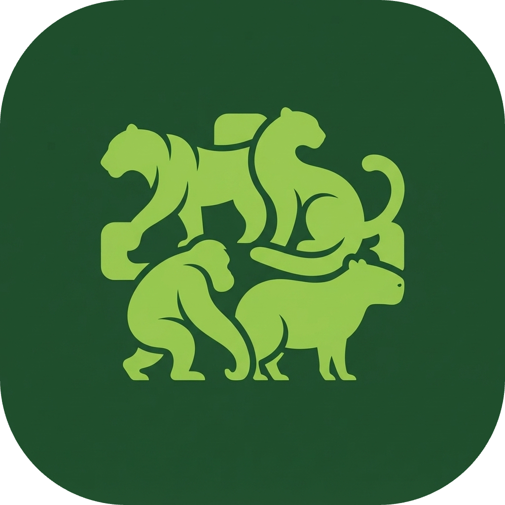

# Zoo de bouzel

Zoo de bouzel est un projet de site web, d'étudiant de 1er années en BUT informatique à l'IUT Aix-Marseille Université - AMU. 

## Liste membres groupe :
| Clément Barre |\
| Gabriel Bressan |\
| Jalan Rigaud |\
| Toan Pradier |

